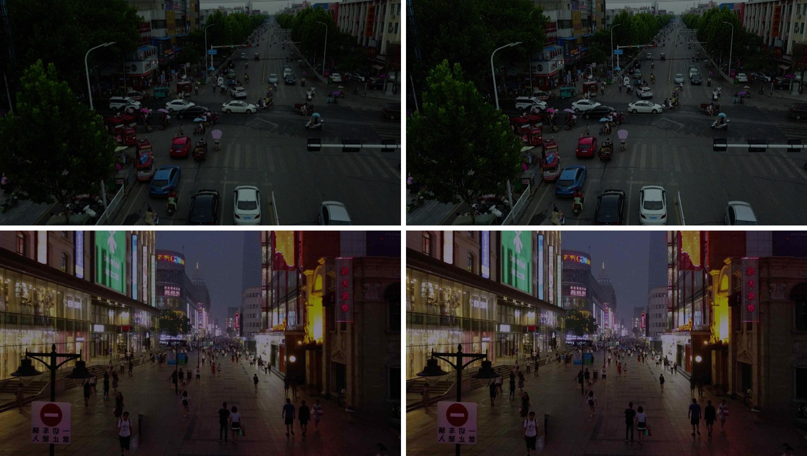
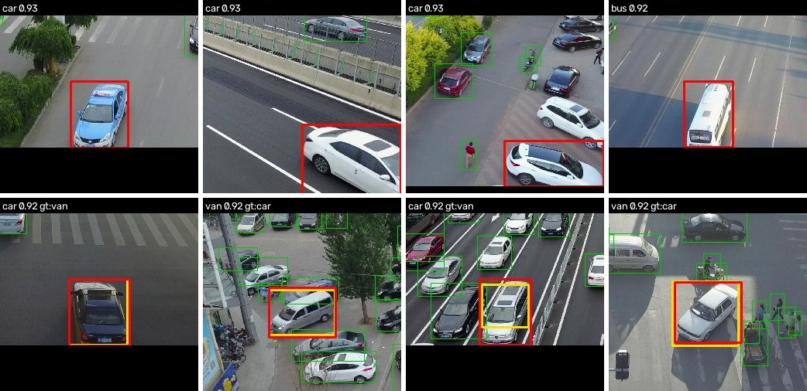

## Validation

The data are 63 labelled drone clips from 55 source videos and 48 short test clips, 8 classes, mostly cars (44%) and people (31%), with small objects (median side 31 px at 1280 input).

Group folds by source video to avoid data leakage with similar frames from the same video. I score 75 frame windows because that's how test does it. I found out local validation was misleading because the best model locally scored worse on the public leaderboard. evalb is the same validation, but blurrier and lower res frames to match test. I train on every 5th frame to avoid overfitting, because neighbouring frames are almost the same. Ignored regions are marked as crowd, and neither detections, neither misses count there.

Average precision is averaged from 0.5 intersection over union threshold for the detection all the way to 95% of intersection over union required. Average precision small is for objects smaller than 32 by 32 pixels in area.

## Models

Faster R-CNN: RPN does the boxes, and ROI head gives us the classifications and refinings of those boxes. I tuned proposal count (the only gain, from .239 to .249), RoI sampling, GIoU loss and anchor sizes.

YOLO is a convolutional network with one attention block. On my data it found fewer small objects than RT-DETR (25% vs 46% of 16-32 px objects).

RT-DETR: queries are attempts to find one object, and they can be overlapping sometimes. Hungarian matching gives each object exactly one query in training, so no NMS is needed. RT-DETR is better than YOLO in dense scenes. The limit of 300 queries did not matter: frames have at most 180 objects, and 500 queries gave the same mAP. Moreover, queries are sometimes the same object.

D-FINE is slower, but it outputs much more quality boxes because it refines each of the boxes. I have seen that RF-DETR beats D-FINE on benchmarks usually. I didn't try it. I stretched the input to a square. D-FINE stretches by default; I did not compare it with letterboxing. D-FINE trained a fixed 20 epochs and I used the last one; held-out mAP rose until epoch 17, then stayed flat. D-FINE kept improving to the end, while YOLO and RT-DETR peaked after a few epochs.

Details of each detector family (baselines, tuning, failure cases, speed) are in notebooks 02-05.

## Pipeline

WBF, weighted boxes fusion, is something I do ensembles with. NMS is simple box overlapping box suppression algorithm. NMS before WBF, because D-FINE outputs many low-score duplicates, and WBF averaged them with the confident boxes (a score dropped from 0.8 to 0.28). That also counts as one of the failure cases of mine. D-FINE gets weight 2 because it is the best model; I set it by hand.

BoT-SORT is a ready tracking algorithm that takes as input detections. I used the Ultralytics implementation. The tracker links boxes of the same object across frames, and each box score is mixed with the best scores of its track. A weak detection of an object that is seen clearly in other frames gets a higher score, while a false positive that appears in only one frame stays low (RT-DETR-x fold 0: from .270 to .282). This algorithm compensates for camera motion, which helps. Camera motion compensation uses optical flow to compensate for the movement of camera. I split at scene cuts because the tracking is independent in those.

Split screen detector uses a logistic regression along the possible grid lines and I designed my own synthetic data and trained it on a few sequence of frames because a single frame failed to learn. It got 95.7% of frames right on held-out synthetic clips (misses: 3-way splits, 680 px frames), and 100% on test against my manual review. I wouldn't say that it counts as tuning on the test set, because I used mock data and it still works on simple images, so it's not overfit, and I think it's just making the detector more robust.

SAHI: I thought the other way first after I tried SAHI inference. I thought it didn't help because I didn't train with it. Slice training did not help (5-fold mAP with SAHI inference: .3209 slice-trained vs .3256 normal training).

## Learned image enhancement (Kornia)

Kornia is a library that gets used for image processings, and it's optimized on GPU well, and I used it for augmentations first, but it worked bad and I switched to albumentations. And I train it together with the detector using detection loss. The last layer starts at zero, so training starts from the unchanged image. The small network that predicts the settings is my own, in the style of IA-YOLO: 5 convolution layers and one linear layer look at a 256 by 256 copy of the image and predict 7 settings (white balance for 3 colours, gamma, contrast, sharpness, unsharp mask). Its scores are within noise and it didn't really help, but with some improvement on dark frames (out-of-fold .3199 vs .3206, public .3813 vs .3822, five darkest labelled clips .463 vs .451).



*Learned Kornia enhancement on the two darkest test clips: original (left), enhanced (right).*

## Experiments and final submissions

I retrained D-FINE with another seed: single folds moved by up to .03, so I treat smaller differences as noise. I try to keep it one change per experiment to track the leaderboard and to not later trying to mix out the experiments in order to choose the best candidate earlier by combining the biggest leverages. To the best of my knowledge, any test data did not leak into training or tuning. Apart that I have seen the multi-panel layout of the videos. D-FINE is pretrained on Objects365 and COCO, not VisDrone. And I specifically did not choose the models that were pre-trained on VisDrone, such as YOLOs I have definitely known, and RF-DETRs also, because I did a data leakage in the first homework and it was a good exercise, but it was no fun and far from the real world usually, where we do not have any data to leak in order to maximize some score.

I was feeling great on a public leaderboard, so I did not try to choose two of the best submissions because I already was winning by a huge margin, so the bigger risk was to overfit to the public leaderboard. So I chose two different submissions, one with SAHI, one without, and one trained to epoch 20 and one to epoch 12 to increase the safety net of decreasing places because of the failing to generalize. However, I still failed to pick the best submission for the private leaderboard. One of my solutions scored higher a bit (D-FINE alone, .3301).

| submission | local mAP | public | private |
|---|---|---|---|
| YOLO11s, fold 0 | .232 | .177 | .171 |
| RT-DETR-l, fold 0 | .305 | .332 | .251 |
| ensemble of 7 RT-DETR / YOLO11 models (5 folds each) | .303 | .365 | .308 |
| + D-FINE-X, BoT-SORT tracking | .313 | .375 | .322 |
| + NMS before WBF, per-panel split screens (final pick 2) | .318 | .382 | .327 |
| + D-FINE 20 epochs, SAHI inference (final pick 1) | .323 | .383 | .330 |
| D-FINE alone, same pipeline | .287 | .377 | .330 |

Local mAP: fold 0 for single models, out-of-fold over all 5 folds for ensembles.

## Additional work

I analyzed with TIDE common errors of my detectors. The biggest error type was wrong class, mostly car vs van, which is mostly labeling ambiguity by annotators; the most confident background errors were mostly unlabelled cars.



*Top-score TIDE errors of RT-DETR-l. Top: detections counted as background, all unlabelled objects. Bottom: car vs van class errors. Green = label, red = prediction.*

I did Weights & Biases as well: [W&B project](https://forge.coreweave.com/wandb/stratiuk-pn-ucu/visdrone-hw2). YOLO, RT-DETR and D-FINE have non-proper curves, so I recorded but not sure whether it counts for the bonus.

I have tried everything I have planned before. I didn't try models that replace SAHI, such as QueryDet or ClusDet, so that might be interesting.

## Final model and run instructions

Final model: `configs/ensembles/final-a-dfine20sahi-full.yaml`. Inference takes about 1.7 s per frame on one GH200 GPU, so it is practical offline, not in real time.

```bash
pip install -e ".[train,notebooks]"   # Python 3.12, CUDA GPU; seeds 0 (seed1 configs: 1)
export VISDET_DATA=/path/to/competition/data VISDET_RUNS=runs
visdet index && visdet check
visdet cache --root cache --step 5
# RT-DETR / YOLO11 members, folds 0-4, every config in configs/final/
visdet run configs/final/final-rtdetr-l-ds.yaml --cache cache --device 0,1,2,3 --fold 0
# D-FINE-X, folds 0-4, from the official D-FINE checkout (VISDET_DFINE)
torchrun --nproc_per_node=4 scripts/dfine_train.py -c configs/dfine/dfine-x-aug20-fold0.yml
python scripts/dfine_predict.py <config> <checkpoint> <out_dir> --fold 0 --cache cache --sahi
# split screens, per-panel predictions, then the ensemble and submission.csv
visdet layout
python scripts/panel_predict.py dfine <run> <out_run> --config "<cfg with {k}>" --checkpoint "<ckpt with {k}>"
visdet ensemble configs/ensembles/final-a-dfine20sahi-full.yaml
```

## Acknowledgements

I just used the fraction of compute given within the frames of our semester project on Borrowing Refusal from Sibling models. We acknowledge EuroHPC Joint Undertaking for awarding us access to JUPITER Booster at the Jülich Supercomputing Centre (JSC), Germany. The FairForget project (EHPC-DEV-2026D09-075) was awarded 3,500 node hours. ELEKS supported this work with a grant in memory of Oleksiy Skrypnyk.

## References

- D-FINE: https://github.com/Peterande/D-FINE
- RT-DETR, YOLO11, BoT-SORT: https://github.com/ultralytics/ultralytics
- Faster R-CNN, RetinaNet: https://github.com/pytorch/vision
- Weighted Boxes Fusion: https://github.com/ZFTurbo/Weighted-Boxes-Fusion
- PySceneDetect: https://github.com/Breakthrough/PySceneDetect
- SAHI: https://github.com/obss/sahi
- IA-YOLO: https://arxiv.org/abs/2112.08088
- Kornia: https://github.com/kornia/kornia
- Albumentations: https://github.com/albumentations-team/albumentations
- TIDE: https://github.com/dbolya/tide
- QueryDet: https://arxiv.org/abs/2103.09136
- ClusDet: https://arxiv.org/abs/1904.08008
